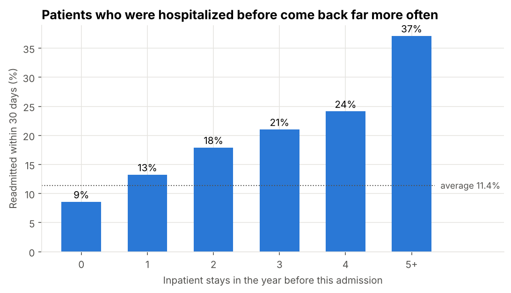
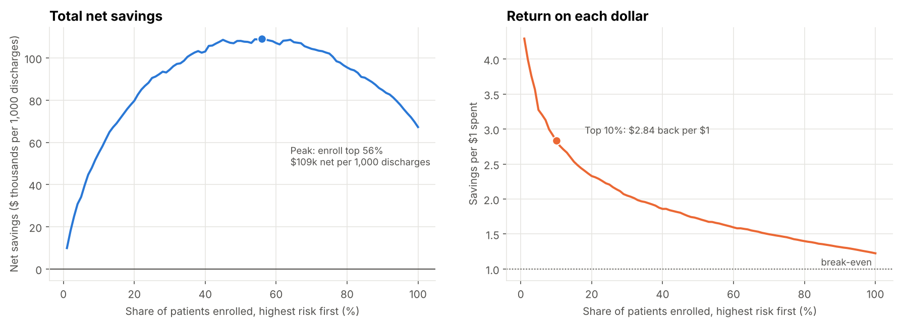
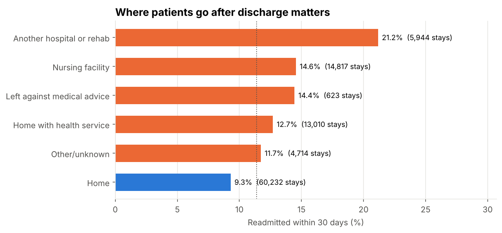
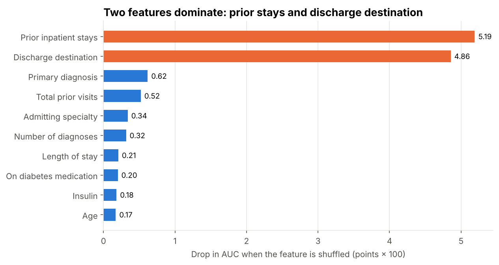
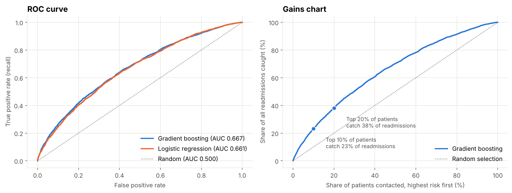
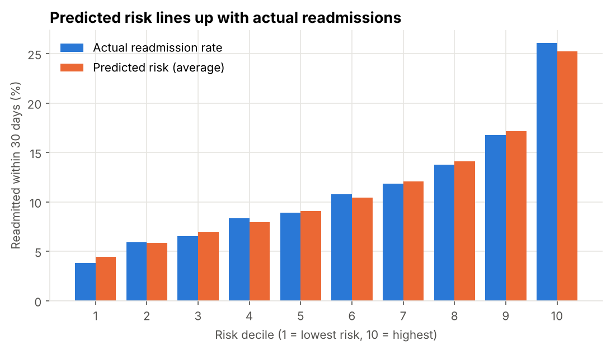
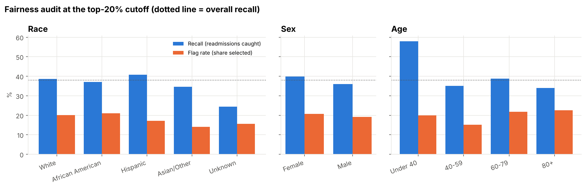

# Predicting 30-Day Hospital Readmissions for Diabetic Patients

**Healthcare analytics · Python · Machine learning · Business case · Fairness audit**

Which diabetic patients are likely to be readmitted within 30 days of discharge, and does it pay to target them with a follow-up program? This project uses 99,340 hospital stays from 130 U.S. hospitals to build a risk model, turn it into a cost-benefit case, and check that it treats patient groups fairly.

- **Full walkthrough notebook:** [`notebooks/readmission_analysis.ipynb`](notebooks/readmission_analysis.ipynb), with code, charts and plain-English explanations step by step.



---

## Key findings

| # | Finding | Evidence |
|---|---|---|
| 1 | **11.4% of eligible stays end in a readmission within 30 days.** | 99,340 stays, 69,987 patients |
| 2 | **Past hospital use is the strongest warning sign.** Patients with 5+ inpatient stays in the prior year were readmitted at 37%, versus 8.6% for patients with none (4.3×). | Readmission rate by prior stays |
| 3 | **Discharge destination matters.** Patients sent to another hospital or rehab were readmitted at 21%, more than twice the 9% rate for patients sent home. | Readmission rate by destination |
| 4 | **The model ranks risk usefully.** Gradient boosting reaches AUC 0.67, in line with published results on this dataset. The top 10% of patients by risk are readmitted at 26%, 2.3× the average. | Held-out test set of 24,757 stays from unseen patients |
| 5 | **Targeting pays.** Enrolling the top 10% in a $300 follow-up program returns about **$2.84 per $1 spent** (about $55,000 net per 1,000 discharges), versus $1.29 for random selection. | Cost-benefit analysis with sourced assumptions |
| 6 | **Fairness:** race is excluded from the model, and the share of readmissions caught is similar for White, African American and Hispanic patients (37% to 41%). The largest gap is by age: patients 80+ have the weakest predictions (AUC 0.61, 34% caught). | Audit by race, sex and age |

---

## Business case

Assumptions: one readmission costs **$16,300** (AHRQ HCUP, 2020 average); the program costs **$300 per patient** (Care Transitions Intervention, Gardner et al., 2014); it prevents **20%** of readmissions among enrolled patients (conservative; the original trial found about 34% fewer).

| Who is enrolled (per 1,000 discharges) | Readmissions prevented | Program cost | Net savings | Return per $1 |
|---|---:|---:|---:|---:|
| Model: top 5% | 3.0 | $15,000 | $34,100 | $3.27 |
| **Model: top 10%** | **5.2** | **$30,000** | **$55,100** | **$2.84** |
| Model: top 20% | 8.6 | $60,000 | $79,700 | $2.33 |
| Model: top 50% | 15.8 | $150,000 | $108,100 | $1.72 |
| Everyone | 22.5 | $300,000 | $67,300 | $1.22 |
| Random 10% (no model) | 2.4 | $30,000 | $8,800 | $1.29 |

- Return per dollar is highest at the top of the risk list; total net savings peak when about the top 56% are enrolled.
- A patient is worth enrolling when predicted risk exceeds **9.2%** (cost ÷ (effectiveness × readmission cost)).
- Targeting the top 10% stays profitable in **17 of 20** cost and effectiveness scenarios tested.



---

## Recommendations

| Audience | Recommendation |
|---|---|
| Care management | Prioritize patients with prior inpatient stays and those discharged to another facility; the model ranks them at discharge. |
| Hospital finance | Fund a follow-up program for the top 10 to 20% of patients; expected return is about $2 to $3 per $1. |
| Quality & compliance | Keep race out of model inputs and audit recall by age and race every quarter. For patients 80+, add frailty and caregiver information. |
| Data teams | Add post-discharge data (follow-up visits, pharmacy fills, social factors) to improve on the 0.67 AUC of hospital-only records. |

---

## Charts

| | |
|---|---|
|  |  |
|  |  |



---

## Data

[Diabetes 130-US Hospitals for Years 1999–2008](https://archive.ics.uci.edu/dataset/296/diabetes+130-us+hospitals+for+years+1999-2008) from the UCI Machine Learning Repository (Strack et al., 2014). 101,766 inpatient stays with demographics, diagnoses (ICD-9), lab tests, medications, prior visits and discharge destination. The raw files are in `data/raw/`.

## Method

1. **Cleaning:** removed stays ending in death or hospice (these patients cannot be readmitted), grouped ICD-9 diagnoses into body systems, grouped admission and discharge codes, and summarized 23 diabetes medications.
2. **Target:** readmission within 30 days (the window hospitals are measured on).
3. **Patient-level split:** 25% of *patients* held out for testing, so no patient appears in both training and test data.
4. **Models:** logistic regression (transparent baseline) and histogram gradient boosting, compared against a simple "any prior inpatient stay" rule.
5. **Evaluation:** AUC, average precision, precision and recall in the top 10% and 20%, and calibration by risk decile.
6. **Interpretation:** permutation importance and logistic-regression odds ratios.
7. **Business case:** program value by share of patients enrolled, break-even risk, and a sensitivity grid over program cost and effectiveness.
8. **Fairness audit:** AUC, flag rate, recall and precision by race, sex and age group at the top-20% cutoff. Race is not a model input.

## Model results (test set)

| Model | AUC | Avg precision | Top 10% precision | Top 10% recall | Top 20% recall |
|---|---:|---:|---:|---:|---:|
| **Gradient boosting** | **0.667** | **0.215** | **26.1%** | **23.2%** | **38.0%** |
| Logistic regression | 0.661 | 0.209 | 24.4% | 21.7% | 36.9% |
| Rule: any prior inpatient stay | 0.591 | – | – | – | – |

## Limitations

- **Old data (1999 to 2008)** and ICD-9 coding; a real deployment would need retraining on current data.
- **Moderate accuracy** (AUC 0.67): the model supports clinical judgment rather than replacing it.
- **Business case relies on published assumptions**, not this population; the sensitivity grid shows how results change.
- **No post-discharge information**, which is where much readmission risk arises.
- **Observational data**: associations are not proof of cause.

## How to run

Open `notebooks/readmission_analysis.ipynb` in Jupyter, VS Code or Google Colab and run all cells. Or run the script version:

```bash
pip install -r requirements.txt
cd src
python readmission_analysis.py      # charts are saved to outputs/figures/
```

## Repository structure

```
hospital-readmission-prediction/
├── data/raw/                          # diabetic_data.csv, IDS_mapping.csv
├── notebooks/readmission_analysis.ipynb
├── src/readmission_analysis.py        # same analysis as a script
├── outputs/
│   ├── figures/                       # charts used above
│   └── results.json                   # every number cited in this README
├── requirements.txt
└── README.md
```

## References

- Strack, B. et al. (2014). Impact of HbA1c Measurement on Hospital Readmission Rates: Analysis of 70,000 Clinical Database Patient Records. *BioMed Research International*.
- AHRQ Healthcare Cost and Utilization Project. [Statistical Brief #304: Characteristics of 30-Day All-Cause Hospital Readmissions, 2016–2020](https://hcup-us.ahrq.gov/reports/statbriefs/sb304-readmissions-2016-2020.pdf).
- Gardner, R. et al. (2014). [Is Implementation of the Care Transitions Intervention Associated with Cost Avoidance After Hospital Discharge?](https://pmc.ncbi.nlm.nih.gov/articles/PMC4026506) *Journal of General Internal Medicine*, 29(6), 878–884.

---

**Author:** Jobayer Ibne Saidur · Business Analytics, University of the Cumberlands · [GitHub @jobayerdu00](https://github.com/jobayerdu00)
